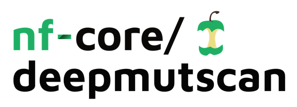
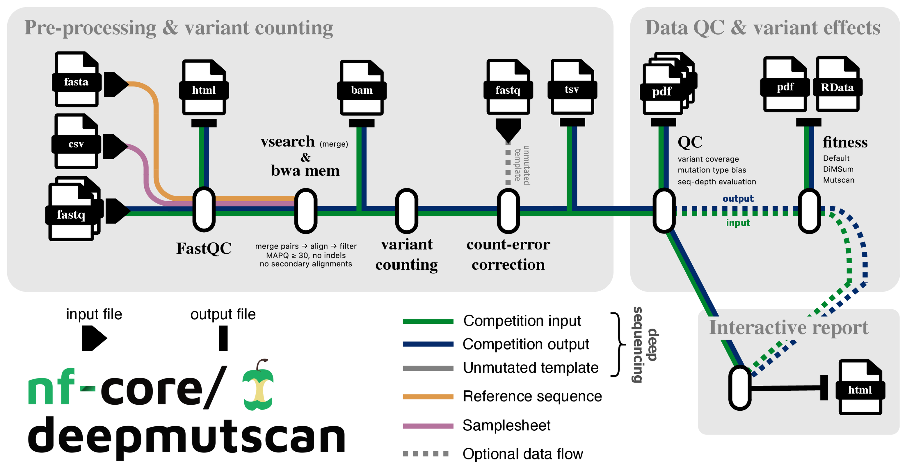

<h1>
  <picture>
    <source media="(prefers-color-scheme: dark)" srcset="docs/images/nf-core-deepmutscan_logo_dark.png">
    
  </picture>
</h1>

[](https://github.com/nf-core/deepmutscan/actions/workflows/ci.yml)
[](https://github.com/nf-core/deepmutscan/actions/workflows/linting.yml)[](https://nf-co.re/deepmutscan/results)[](https://doi.org/10.5281/zenodo.XXXXXXX)
[](https://www.nf-test.com)

[](https://www.nextflow.io/)
[](https://github.com/nf-core/tools/releases/tag/4.1.0)
[](https://docs.conda.io/en/latest/)
[](https://www.docker.com/)
[](https://sylabs.io/docs/)
[](https://cloud.seqera.io/launch?pipeline=https://github.com/nf-core/deepmutscan)

[](https://nfcore.slack.com/channels/deepmutscan)[](https://twitter.com/nf_core)[](https://mstdn.science/@nf_core)[](https://www.youtube.com/c/nf-core)

## Introduction

**nf-core/deepmutscan** is a workflow designed for the analysis of deep mutational scanning (DMS) data. DMS enables researchers to experimentally measure the fitness effects of thousands of gene variants simultaneously, helping to classify disease-causing mutants in human and other species populations, and to learn the fundamental rules of protein architecture, small-molecule binding, mRNA splicing, viral evolution and many other quantifiable phenotypes.

While DNA synthesis and sequencing technologies have advanced substantially, long open reading frame (ORF) targets still present a major challenge for DMS studies. Shotgun DNA sequencing of randomly fragmented variant libraries can greatly speed up the inference of long ORF mutant fitness landscapes, as it avoids the need for library barcoding or multi-tile sequencing. We have designed `nf-core/deepmutscan` to unlock shotgun sequencing-based DMS studies on long ORFs, and to simplify and standardise the bioinformatics steps involved in processing such experiments – from read alignment to QC reporting, variant count error correction and fitness landscape inference. Amplicon (tile) sequencing data can be processed in the same way.



## Major features

- End-to-end processing of DMS libraries from shotgun (randomly fragmented) or amplicon short-read sequencing
- Light-weight variant counter with base-quality and read-edge filters, replacing `GATK AnalyzeSaturationMutagenesis`
- Intrinsic sequencing-error correction of single-nucleotide variant counts from read-linked false double mutants (maximum-likelihood or empirical-Bayes estimators), or from additional wildtype template sequencing
- Library quality control: mutant count heatmaps, positional coverage and mutation-type biases, sequencing-depth rarefaction
- Fitness estimation with a built-in log-ratio estimator, plus optional [DiMSum](https://github.com/lehner-lab/DiMSum) and [mutscan](https://github.com/fmicompbio/mutscan)
- Support for degenerate codon libraries (NNK, NNS, NNH, NNN and combinations), e.g. from nicking mutagenesis, and for custom (position-specific) codon libraries, e.g. from Twist tiles
- A single, self-contained HTML report per run, and an optional interactive 3D variant effect inspection tool when a wildtype structure is supplied
- Containerisation via Docker, Singularity/Apptainer and Conda; scalability across HPC and cloud systems

For more details on the individual steps and on planned extensions, please read the [usage documentation](https://nf-co.re/deepmutscan/usage).

## Pipeline summary

1. Raw read QC ([`FastQC`](https://www.bioinformatics.babraham.ac.uk/projects/fastqc/))
2. Alignment of reads to the reference ORF ([`BWA-MEM`](https://github.com/lh3/bwa))
3. Filtering of unmapped, secondary, low mapping-quality and indel-containing alignments ([`samtools view`](https://www.htslib.org/))
4. Merging of overlapping read pairs into consensus reads for base error reduction ([`vsearch --fastq_mergepairs`](https://github.com/torognes/vsearch)), re-alignment, sorting and indexing ([`samtools`](https://www.htslib.org/))
5. Variant counting (custom counter built on [`pysam`](https://github.com/pysam-developers/pysam) and [`polars`](https://pola.rs))
6. Annotation and filtering of variant counts against the programmed mutagenesis library
7. Single-nucleotide variant sequencing-error correction via false double mutants or wildtype sequencing
8. DMS library quality control and visualisation
9. _Optional:_ fitness estimation from matched input/output samples (default estimator, [`DiMSum`](https://github.com/lehner-lab/DiMSum), [`mutscan`](https://github.com/fmicompbio/mutscan)) and interactive 3D variant effect inspection tool ([`3Dmol.js`](https://3dmol.csb.pitt.edu/))
10. An all-in-one `deepmutscan_report.html`

## Usage

> [!NOTE]
> If you are new to Nextflow and nf-core, please refer to [this page](https://nf-co.re/docs/get_started/environment_setup/overview) on how to set-up Nextflow. Make sure to [test your setup](https://nf-co.re/docs/get_started/run-your-first-pipeline) with `-profile test` before running the workflow on actual data.

First, prepare a samplesheet with your input data. Each row represents one sequencing library as a pair of FASTQ files (paired-end), annotated with the biological sample, its type in the selection experiment (`input`, `output` or `wildtype`) and the replicate number:

```csv title="samplesheet.csv"
sample,type,replicate,file1,file2
ORF1,input,1,/reads/input1_R1.fastq.gz,/reads/input1_R2.fastq.gz
ORF1,input,2,/reads/input2_R1.fastq.gz,/reads/input2_R2.fastq.gz
ORF1,output,1,/reads/output1_R1.fastq.gz,/reads/output1_R2.fastq.gz
ORF1,output,2,/reads/output2_R1.fastq.gz,/reads/output2_R2.fastq.gz
```

Secondly, provide the gene or gene region of interest as a reference FASTA file via `--fasta`, and the nucleotide coordinates of the mutagenised open reading frame within it via `--reading_frame` (1-based, inclusive, e.g. `1-300` for the first 100 codons).

Now, you can run the pipeline using:

```bash title="example_run.sh"
nextflow run nf-core/deepmutscan \
   -profile <docker/singularity/.../institute> \
   --input ./samplesheet.csv \
   --fasta ./ref.fa \
   --reading_frame 1-300 \
   --outdir ./results
```

Add `--fitness` to estimate variant fitness from the input and output samples, and see the [usage documentation](https://nf-co.re/deepmutscan/usage) and the [parameter documentation](https://nf-co.re/deepmutscan/parameters) for all other options.

> [!WARNING]
> Please provide pipeline parameters via the CLI or Nextflow `-params-file` option. Custom config files including those provided by the `-c` Nextflow option can be used to provide any configuration _**except for parameters**_; see [docs](https://nf-co.re/docs/usage/getting_started/configuration#custom-configuration-files).

## Pipeline output

To see the results of an example test run with a full size dataset refer to the [results](https://nf-co.re/deepmutscan/results) tab on the nf-core website pipeline page.
For more details about the output files and reports, please refer to the [output documentation](https://nf-co.re/deepmutscan/output).

## Credits

nf-core/deepmutscan was originally written by [Benjamin Wehnert](https://github.com/BenjaminWehnert1008) and [Maximilian Stammnitz](https://github.com/MaximilianStammnitz) at the [Centre for Genomic Regulation (CRG), Barcelona](https://www.crg.eu/), with the generous support of an EMBO Long-term Postdoctoral Fellowship, the Erasmus+ programme and a Marie Skłodowska-Curie grant by the European Union.

We thank the following people for their extensive assistance in the development of this pipeline:

- [Fei Sang](https://github.com/fei-hgi) (Wellcome Sanger Institute) – original variant counting implementation
- [Júlia Mir-Pedrol](https://github.com/mirpedrol) (CRG) – nf-core development guidance and code review
- [Matthias Hörtenhuber](https://github.com/mashehu) (SciLifeLab) – nf-core development guidance and code review

## Contributions and Support

If you would like to contribute to this pipeline, please see the [contributing guidelines](docs/CONTRIBUTING.md).

For further information or help, don't hesitate to get in touch on the [Slack `#deepmutscan` channel](https://nfcore.slack.com/channels/deepmutscan) (you can join with [this invite](https://nf-co.re/join/slack)). Bug reports and feature requests are welcome as GitHub [issues](https://github.com/nf-core/deepmutscan/issues).

For scientific discussions around the use of this pipeline (e.g. on experimental design or sequencing data requirements), please feel free to get in touch with us directly:

- Benjamin Wehnert — wehnertbenjamin@gmail.com
- Maximilian Stammnitz — maximilian.stammnitz@crg.eu

## Citations

If you use `nf-core/deepmutscan` for your analysis, please cite it as follows:

> Wehnert B, et al. _bioRxiv_ preprint (in preparation).

<!-- Add the Zenodo DOI after the first release: -->
<!-- If you use nf-core/deepmutscan for your analysis, please cite it using the following doi: [10.5281/zenodo.XXXXXX](https://doi.org/10.5281/zenodo.XXXXXX) -->

An extensive list of references for the tools used by the pipeline can be found in the [`CITATIONS.md`](CITATIONS.md) file.

You can cite the `nf-core` publication as follows:

> **The nf-core framework for community-curated bioinformatics pipelines.**
>
> Philip Ewels, Alexander Peltzer, Sven Fillinger, Harshil Patel, Johannes Alneberg, Andreas Wilm, Maxime Ulysse Garcia, Paolo Di Tommaso & Sven Nahnsen.
>
> _Nat Biotechnol._ 2020 Feb 13. doi: [10.1038/s41587-020-0439-x](https://dx.doi.org/10.1038/s41587-020-0439-x).
