# nf-core/deepmutscan: Output

## Introduction

This document describes the output produced by the `nf-core/deepmutscan` pipeline.

The directories listed below will be created in the results directory after the pipeline has finished. All paths are relative to the top-level results directory. Library-specific files are named, or placed in subfolders named, after the library identifier `<library>`, built from the samplesheet as `<sample>_<type>_<replicate>_pe` (e.g. `GID1A_input_1_pe`).

```tree title="nf-core/deepmutscan results"
results/
├── deepmutscan_report.html              # all-in-one, self-contained run report
├── raw_data_qc/                         # raw read QC per FASTQ file (Falco)
├── multiqc/                             # MultiQC report across all FASTQ files
├── intermediate_files/                  # reference index, alignments, variant count tables, error correction
│   ├── bwamem3/
│   ├── merged_reads/                    # read-pair merging statistics
│   ├── bam_files/sorted/                # the sorted, indexed BAM, only with --save_bam
│   ├── variant_counts/<library>/
│   └── processed_variant_counts/<library>/
├── library_QC/                          # per-library QC plots + run-level error-correction report
│   └── <library>/
├── fitness/                             # fitness results, mostly only with --fitness
│   ├── default_results/
│   ├── DiMSum_results/                  # only with --dimsum
│   └── mutscan_results/                 # only with --mutscan
├── variant_effect_inspection_tool/      # only with --fitness and --pdb
└── pipeline_info/                       # Nextflow and pipeline run information
```

## Pipeline overview

The pipeline is built using [Nextflow](https://www.nextflow.io/) and processes data using the following key steps:

- [Raw data QC](#raw-data-qc) - Raw read QC (Falco)
- [MultiQC](#multiqc) - Aggregate report describing results and QC from the whole pipeline
- [Intermediate files](#intermediate-files) - Reference index, alignments and variant count tables
- [Error correction](#error-correction) - Sequencing-error corrected count tables and report
- [Library QC](#library-qc) - Per-sample visualisations of mutation efficiency, coverage and saturation
- [Fitness](#fitness) - Merged counts and fitness estimates (optional)
- [Variant effect inspection tool](#variant-effect-inspection-tool) - Interactive 3D structure viewer (optional)
- [All-in-one report](#all-in-one-report) - Self-contained HTML report of the whole run
- [Pipeline information](#pipeline-information) - Report metrics generated during the workflow execution

### Raw data QC

<details markdown="1">
<summary>Output files</summary>

- `raw_data_qc/`
  - `<library>_{1,2}_fastqc_data.txt`: the quality metrics of each FASTQ file in FastQC's tab-delimited format (read by MultiQC).
  - `<library>_{1,2}_falco_report.html`: Falco's HTML report of each FASTQ file. Its plots load plotly.js from a CDN, so they need an internet connection; the same plots are in the MultiQC report and the all-in-one report, which work offline.
  - `<library>_{1,2}_falco_summary.txt`: PASS / WARN / FAIL of each FastQC module.

</details>

[Falco](https://github.com/smithlabcode/falco) runs [FastQC](http://www.bioinformatics.babraham.ac.uk/projects/fastqc/)'s analyses and writes its data format at a fraction of the cost (about a tenth of FastQC's CPU time and a fortieth of its memory). It gives general quality metrics about your sequenced reads: the quality score distribution across your reads, per base sequence content (%A/T/G/C), adapter contamination estimates and overrepresented sequences. The numbers are those FastQC reports. The per-module PASS / WARN / FAIL grades agree with FastQC's, except for two modules: Falco 2.0.3 compares overrepresented sequences and adapter content with its cutoffs in the wrong units, so these two can read PASS where FastQC's cutoffs give WARN or FAIL (reported as [smithlabcode/falco#145](https://github.com/smithlabcode/falco/issues/145), with a fix proposed in [#146](https://github.com/smithlabcode/falco/pull/146)). Their percentages, in the tables and plots, are correct. For further reading see the [FastQC help pages](http://www.bioinformatics.babraham.ac.uk/projects/fastqc/Help/). Before Falco runs, `fq lint` checks that the two files of every library are complete and consistent; the run stops with one message listing every library that fails.

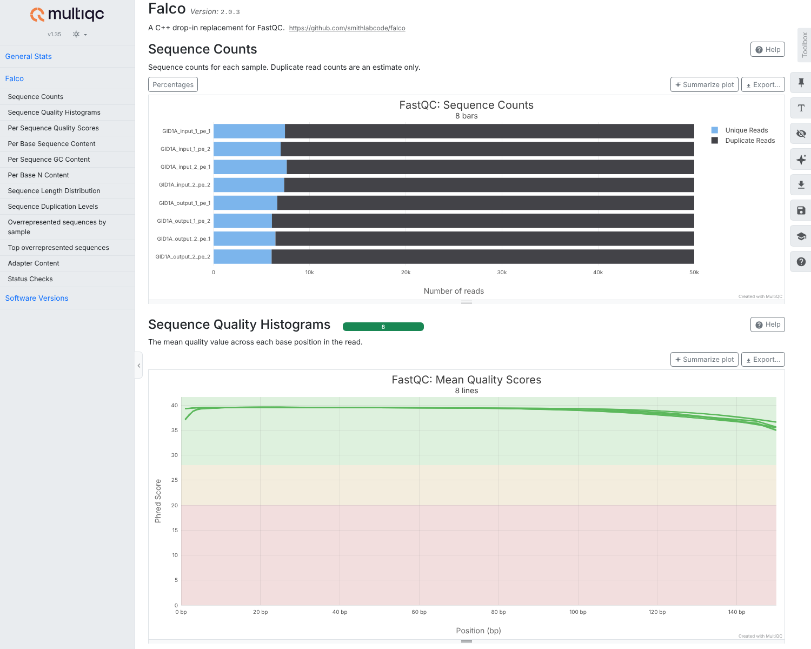

### MultiQC

<details markdown="1">
<summary>Output files</summary>

- `multiqc/`
  - `multiqc_report.html`: a standalone HTML file that can be viewed in your web browser.
  - `multiqc_data/`: directory containing parsed statistics from the different tools used in the pipeline.
  - `multiqc_plots/`: directory containing static images from the report in various formats.

</details>

[MultiQC](http://multiqc.info) is a visualization tool that generates a single HTML report summarising all the sequenced samples in your project. Most of the pipeline QC results are visualised in the all-in-one report and further statistics are available in the report data directory. The pipeline has special steps which also allow the software versions to be reported in the MultiQC output for future traceability. For more information about how to use MultiQC reports, see <http://multiqc.info>.

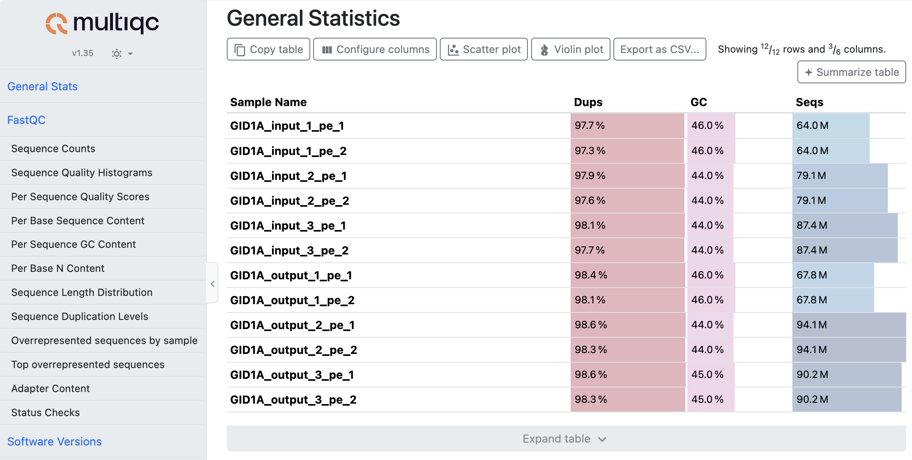
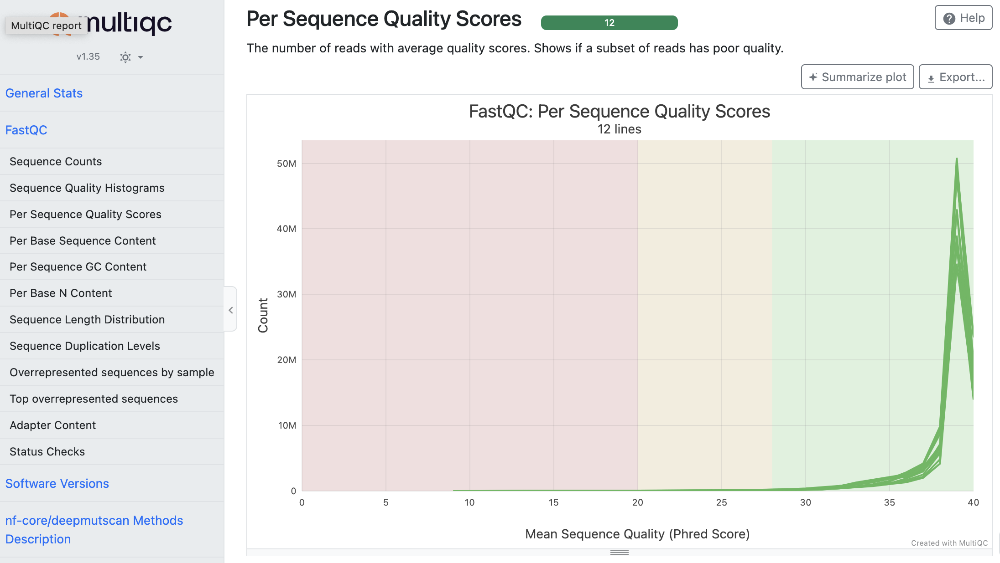
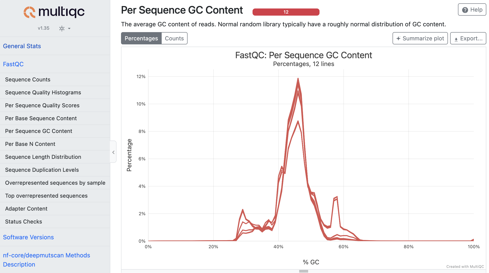

### Intermediate files

<details markdown="1">
<summary>Output files</summary>

- `intermediate_files/`
  - `aa_seq.txt`: wildtype amino acid sequence translated from `--reading_frame`.
  - `possible_mutations.csv`: all programmed codon variants per position, as defined by `--mutagenesis_type`; used for library filtering and visualisation.
  - `bwamem3/`: bwa-mem3 index of the reference FASTA in upper case (`<name>.uppercase.fasta.{amb,ann,bwt.2bit.64,pac}`).
  - `merged_reads/<library>.vsearch_mergepairs.log`: read-pair merging statistics from vsearch (pairs merged, reasons for failed merges, fragment lengths, expected errors).
  - `bam_files/sorted/<library>.sorted.bam` and `.bai` (only with `--save_bam`): the coordinate-sorted,
    indexed alignments of the merged read pairs, after filtering (mapped, primary, MAPQ >= 30) - what
    the variant counter reads. Alignments with an insertion, deletion or reference skip are kept in the
    BAM but ignored by the counter. Merging, alignment, filtering and counting run as one stream, and
    the counter does not need the alignments sorted, so without `--save_bam` no BAM is written at all.
  - `variant_counts/<library>/<library>.variant_counts.tsv`: variant count table with one row per observed combination of nucleotide changes, its count, coverage and codon / amino acid annotation. No count threshold is applied here: `--min_counts` acts only on fitness estimation.
  - `variant_counts/<library>/variant_counts_columns.tsv`: description of every column of the variant count table.
  - `processed_variant_counts/<library>/`:
    - `annotated_variantCounts.csv`: variant counts annotated with codon and amino acid changes and counts per coverage.
    - `variantCounts_filtered_by_library.csv`: single-codon variants that match the programmed library.
    - `library_completed_variantCounts.csv`: all programmed variants, including unobserved ones (counts 0, `observed` FALSE), used for the LogDiff plots.
    - `variantCounts_for_heatmaps.csv`: counts and counts per coverage aggregated per position and amino acid, used for the count heatmaps.

</details>

These files document every step from raw reads to variant frequencies.

### Error correction

<details markdown="1">
<summary>Output files</summary>

- `intermediate_files/processed_variant_counts/<library>/` (unless `--error_correction none`)
  - `variantCounts_filtered_by_library_error_corrected.csv`, `library_completed_variantCounts_error_corrected.csv`, `variantCounts_for_heatmaps_error_corrected.csv`: corrected versions of the tables above. The corrected counts are used by all downstream steps; in `variantCounts_filtered_by_library_error_corrected.csv`, the original counts are kept in the `counts_raw` and `counts_per_cov_raw` columns.
  - `seq_error_rate.csv` (`--error_correction false_doubles` only): for every possible single-nucleotide substitution along the reference, its observed frequency (`1nt counts/coverage`), the error rate subtracted (`1nt false counts/coverage`), this library's false-double reads and exposure (`false double reads (F)`, `exposure (M)`), the pooled evidence the rate was estimated from (`pooled F`, `pooled M`) and, for `--false_doubles_method eb`, the prior mean, prior strength and shrinkage weight (the share of the estimate that comes from the variant's own evidence).
  - `fdm_evidence.csv`, `fdm_evidence_summary.csv` (`--error_correction false_doubles` only): the false-double evidence of this library per single-nucleotide variant (substitution type, trinucleotide context, _F_, _M_), and a one-line summary including the fitted decay of joint coverage with codon distance the genuine-double measurement (`gd_reads`, `gd_exposure`, `gd_kappa`: reads carrying two programmed multi-nucleotide variants, relative to independent co-occurrence) and the false-double rate inside versus outside the `--min_FDdist` exclusion (`near_*`, `far_*`). `fdm_exposure_by_distance.csv` gives the same exposure _M_ resolved by the codon distance to the anchor, which the pooled fit needs to weight each anchor by kappa at its own distance.
  - `fdm_distance_profile.csv` (`--error_correction false_doubles` only): per codon distance between a variant and its anchor, the false-double reads and exposure and the genuine-double reads and expectation; drives the report's anchor section.
- `intermediate_files/false_doubles_pools/<pool>/` (`--error_correction false_doubles` only), one folder per pool of libraries (`--false_doubles_pooling`)
  - `fdm_rates.csv`: pooled evidence and estimated error rate of every single-nucleotide variant.
  - `fdm_rates_per_library.csv`: the same estimator applied to each library of the pool alone, for comparison in the report (not used for correction).
  - `fdm_prior_fit.csv`: the fitted empirical-Bayes prior per level (global, substitution type, trinucleotide context) – pooled rate, prior mean, prior strength `nu` and whether it was fitted or inherited from the level above – and the pool's median shrinkage weight.
- `error_signatures/<pool>/` (`--error_correction false_doubles`, unless `--skip_error_signatures`), one folder per pool of libraries
  - `error_signatures.csv`: the signatures selected for each spectrum (`fdm`; with a wildtype library also `wt` and `excess`), their exposures with bootstrap 95 % intervals, the reconstruction cosine and the share of reads the reconstruction accounts for.
  - `error_spectra.csv`: the 96-channel spectra on GRCh37 trinucleotide composition and each selected signature's contribution to their reconstruction.
  - `error_signatures.json`: everything above plus the candidate screen and the forward-selection curve, as read by the report.
- `library_QC/`
  - `error_correction_report.html`: interactive report of the correction across all libraries of the run. **1 · ERROR REPRODUCIBILITY** sets the pooled error rate(s) (top rows) against every library's own estimate, as a correlation matrix with a scatter for each pair. **ERROR EVIDENCE** (`--error_correction false_doubles` only) plots, against the codon distance between the two changes, the genuine double-mutant rate (reads carrying two programmed codon variants — 2+2, 3+2, 3+3 changed bases — which no sequencing error can create) above the false-double rate (an anchor plus one changed base, 2+1 or 3+1: the error evidence), both per anchor-spanning read on one 10⁻⁷–10⁻² axis; the `--min_FDdist` window is shaded. **ERROR SPECTRUM** shows the 96-channel spectrum of the errors this run corrects — the wildtype-template errors under `--error_correction wildtype`, the false-double errors under `false_doubles` — with its signature reconstruction and a one-line description of each signature. **2 · ERROR IMPACT** shows raw versus corrected frequency, one panel per corrected file. **3 · SINGLE FILE** recomputes every panel for one chosen file. Error-frequency axes are fixed at 10⁻⁷ to 10⁻² throughout, so panels compare directly.

</details>

The error-correction report shows the single-nucleotide substitution error correlation across samples, raw versus corrected counts, the distribution of per-variant correction magnitudes, positional error bias along the ORF and a searchable per-variant table. Libraries can be selected and deselected in the report, for example to compare input and output libraries.

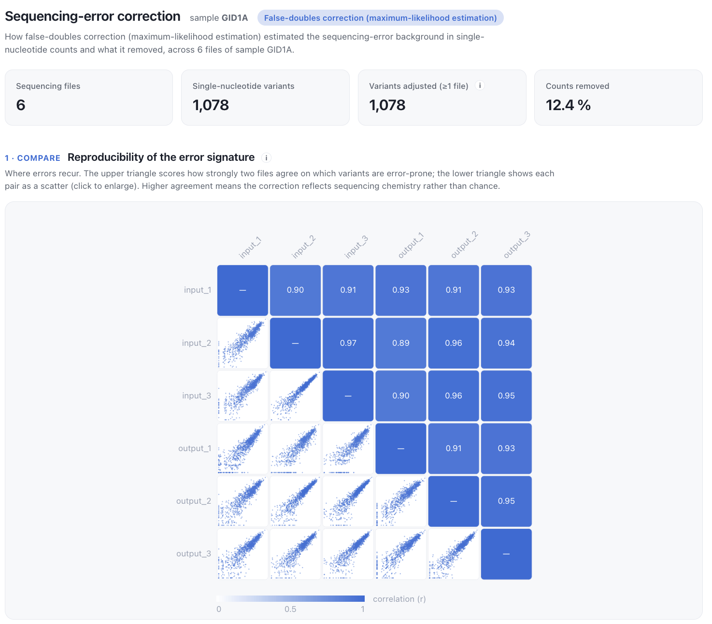
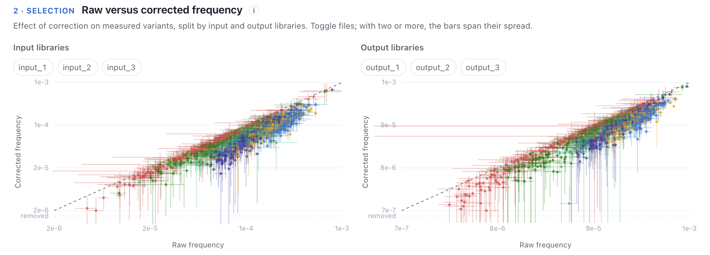


### Library QC

<details markdown="1">
<summary>Output files</summary>

- `library_QC/<library>/`
  - `counts_heatmap.pdf`: variant counts per position (x-axis) and mutant amino acid (y-axis).
  - `counts_per_cov_heatmap.pdf`: as above, but as counts per sequencing coverage.
  - `logdiff_plot.pdf`: sorted, log-scale distribution of counts per coverage of all programmed variants, with the log10 ratio of their 90th and 10th percentiles (LogDiff) and the number of variants without counts. Variants without counts (never observed, or corrected to 0) are drawn at half the lowest observed counts per coverage. When they make up more than 10% of the library, the 10th percentile would be this floor, so LogDiff is not reported; the share of variants without counts is shown instead.
  - `logdiff_varying_bases.pdf`: as above, stratified by the number of changed nucleotides per codon.
  - `rolling_coverage.pdf`: sliding-window sequencing coverage along the ORF, with the coverage required to observe every amino acid variant `--aimed_cov` times.
  - `rolling_counts.pdf`: sliding-window variant counts along the ORF, stratified by the number of changed nucleotides per codon.
  - `rolling_counts_per_cov.pdf`: as above, but as counts per coverage.
  - `SeqDepth.pdf` and `seqdepth_curve.csv` (with `--run_seqdepth`, default): sequencing-depth rarefaction curve, i.e. the expected fraction of programmed variants that remain detected when the library is subsampled to lower sequencing depths.

</details>

These plots help to judge the success of the mutagenesis (are all positions and amino acids represented?), the evenness of the fragmentation and sequencing coverage along the ORF, and whether a library was sequenced deeply enough.

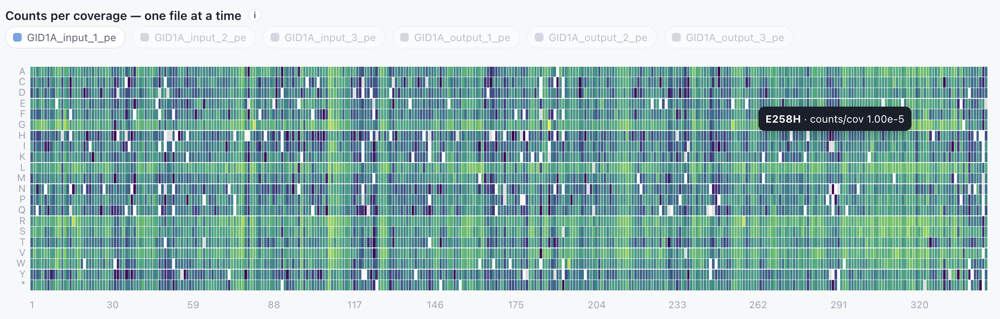
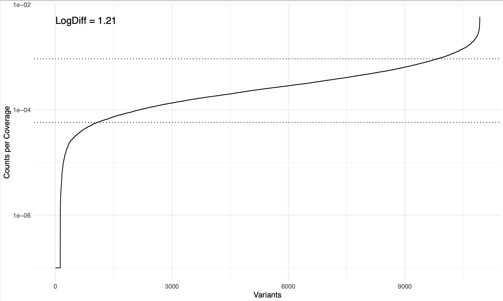
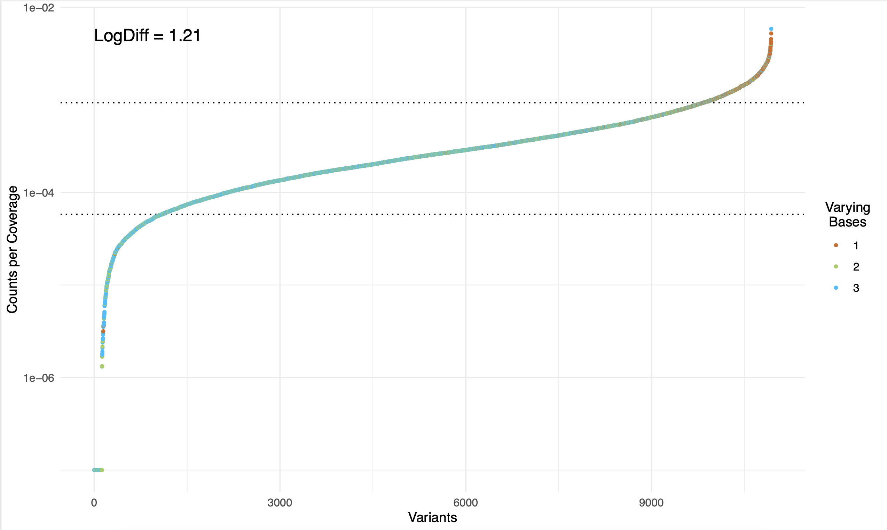
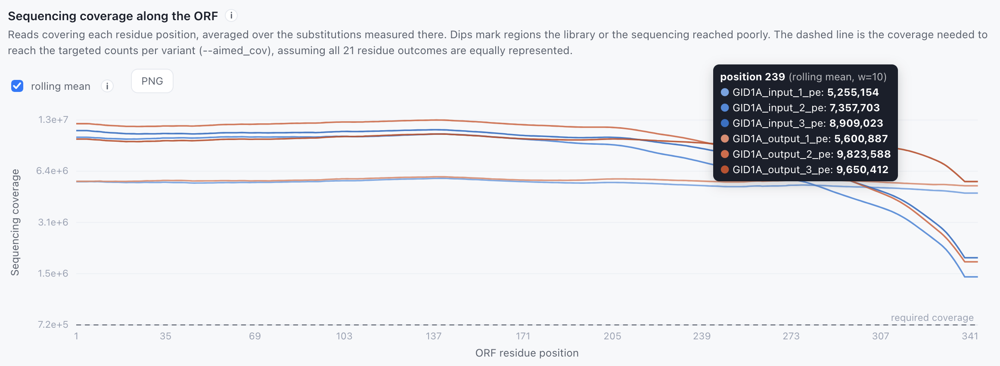
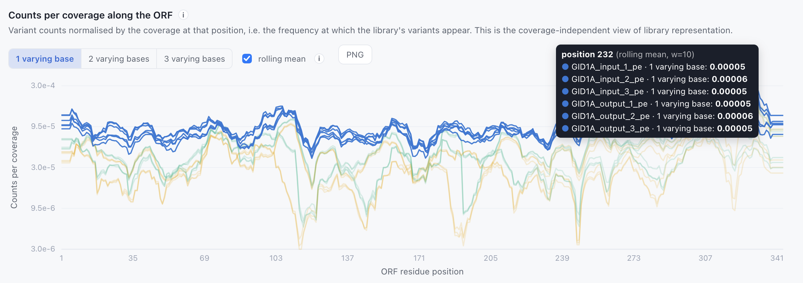
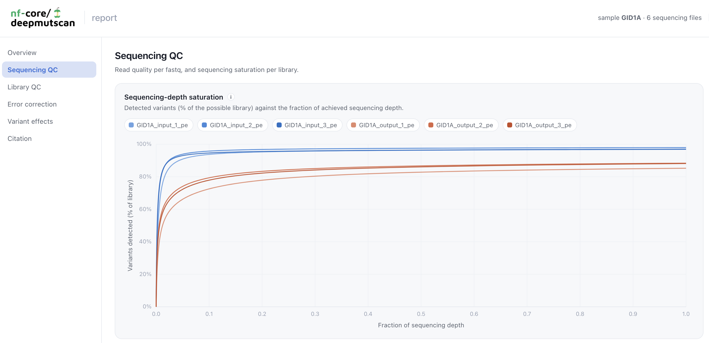

### Fitness

<details markdown="1">
<summary>Output files</summary>

- `fitness/`
  - `counts_merged.tsv`: merged variant counts of all `input` and `output` libraries of a sample.
  - `experimentalDesign.tsv`: experimental design derived from the original samplesheet (DiMSum input format).
  - `synonymous_wt.txt`: nucleotide sequence of the synonymous variant used as wildtype proxy.
  - `default_results/`
    - `fitness_estimation.tsv`: per-variant counts, raw and rescaled fitness per replicate, and mean fitness and standard deviation across replicates.
    - `fitness_estimation_count_correlation.pdf`: pairwise variant count correlations between all libraries.
    - `fitness_estimation_fitness_correlation.pdf`: pairwise fitness correlations between replicates.
    - `fitness_heatmap.pdf`: mean fitness per position (x-axis) and mutant amino acid (y-axis).
  - `single_rep_counts/<library>_fitness_input.tsv`: per-library count tables in DiMSum input format. These are written for every run, also without `--fitness`.
  - `DiMSum_results/`
    - `single_rep_counts/<library>_fitness_input.tsv` (with `--dimsum`): per-library count tables in DiMSum input format.
    - `dimsum_results/` (with `--dimsum`): the complete [DiMSum](https://github.com/lehner-lab/DiMSum) default output, including its HTML `report.html`, fitness tables (`fitness_singles.txt`, `fitness_doubles.txt`, `fitness_synonymous.txt`, `fitness_wildtype.txt`, `fitness_singles_MaveDB.csv`) and `.RData` objects.
  - `mutscan_results/` (with `--mutscan`)
    - `fitness_estimation_mutscan_edgeR.tsv`, `fitness_estimation_mutscan_limma.tsv`: [mutscan](https://github.com/fmicompbio/mutscan) default variant enrichment estimates with edgeR and limma.
    - `mutscan_counts_corr.pdf`, `mutscan_edgeR_volcano.pdf`, `mutscan_limma_volcano.pdf`: count correlation and volcano plots.

</details>

Fitness is only estimated with `--fitness` and requires at least one `input` and one `output` library per sample. See the [usage documentation](usage.md#8-fitness-estimation-optional) for how fitness is calculated. Fitness values are scaled so that wild-type synonymous variants centre on 0 and stop codon (nonsense) variants on -1.

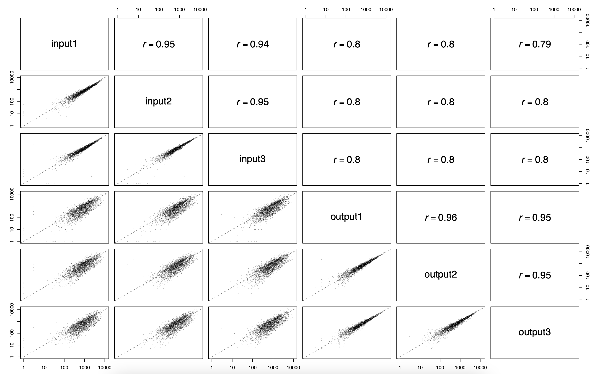
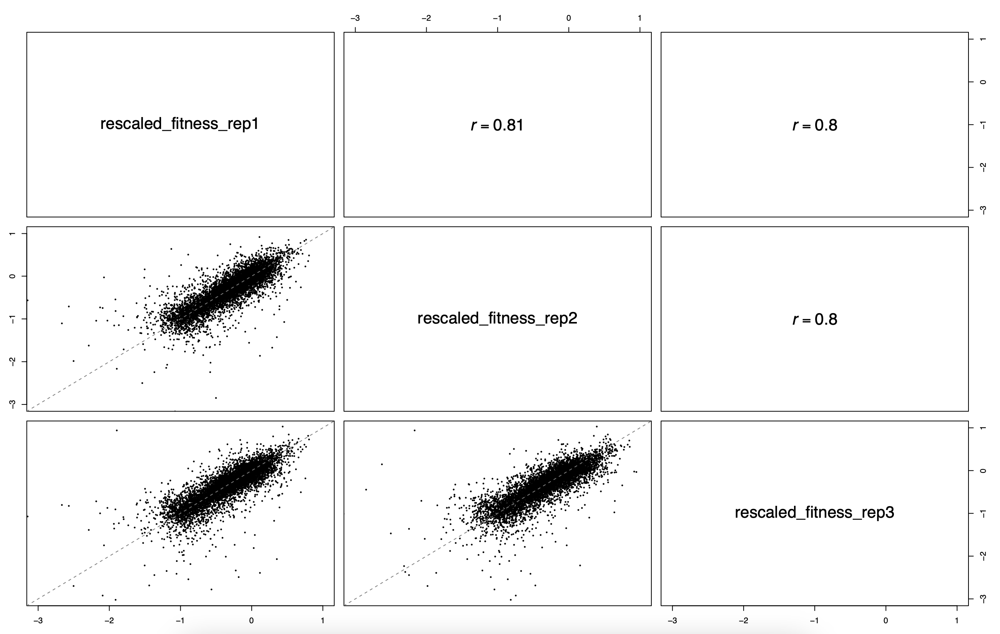
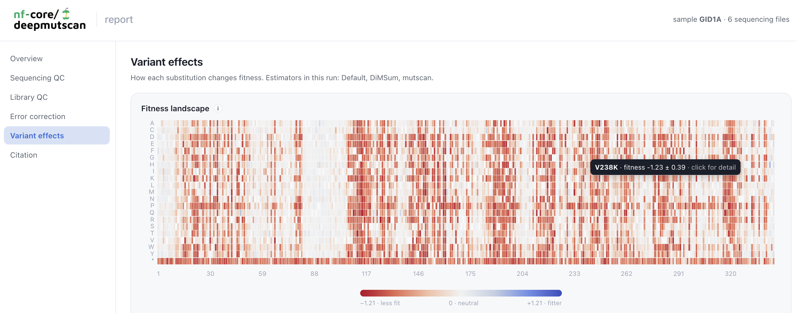

### Variant effect inspection tool

<details markdown="1">
<summary>Output files</summary>

- `variant_effect_inspection_tool/` (with `--fitness` and `--pdb`)
  - `variant_effect_inspection_tool.html`: self-contained, interactive 3D structure viewer.
  - `structure_data.json`: the per-residue and per-variant data shown in the viewer.

</details>

This tool projects the mean per-residue fitness, coverage, counts, counts per coverage and – when error correction is on – the positional error bias onto the supplied wildtype 3D structure. Selecting a residue shows the effect of each substitution. The file works offline and can be shared as a single file.

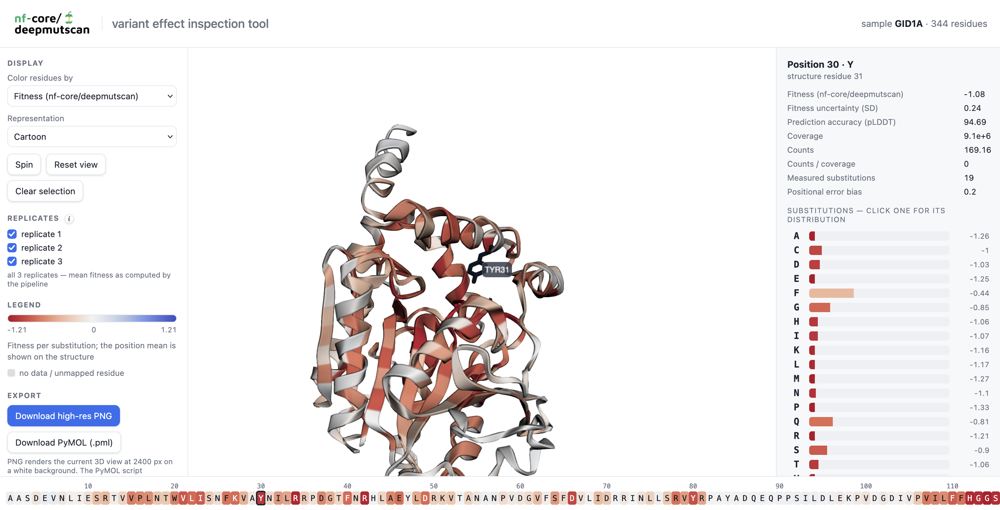

### All-in-one report

<details markdown="1">
<summary>Output files</summary>

- `deepmutscan_report.html`: a single, self-contained HTML report of the run.

</details>

The report brings all the important metrics and visual results of a run together in one file; it can be opened in any browser and shared without any accompanying files. Features are a complete `nf-core` run overview with parameters and links to Nextflow's execution report and timeline, interactive sequencing and library QC plots per library, the error-correction report, the fitness results and heatmap (with `--fitness`), the DiMSum and mutscan results (if run), a 3D structure view (with `--pdb`), the MultiQC report, and the citations of all the tools and major dependencies that were used in the run.

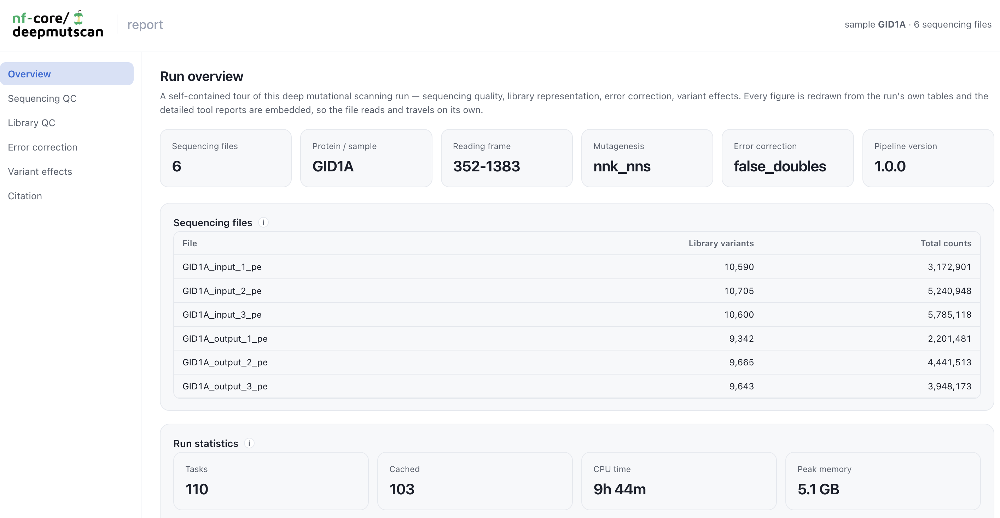

### Pipeline information

<details markdown="1">
<summary>Output files</summary>

- `pipeline_info/`
  - Reports generated by Nextflow: `execution_report_<timestamp>.html`, `execution_timeline_<timestamp>.html`, `execution_trace_<timestamp>.txt` and `pipeline_dag_<timestamp>.html`.
  - Carbon-footprint estimate of the run by [nf-co2footprint](https://nextflow-io.github.io/nf-co2footprint/): `co2footprint_report_<timestamp>.html` (per-process energy use and CO₂e, overview plots), `co2footprint_summary_<timestamp>.txt` and `co2footprint_trace_<timestamp>.txt` (one line per task). The estimate follows the Green Algorithms method from the resources each task used and requested; set `--co2_location` (Electricity Maps zone of the compute site) in a site profile for the local grid mix instead of the global average, and the data-centre PUE in a `co2footprint { pue = ... }` block of the same profile.
  - Reports generated by the pipeline: `pipeline_report.html`, `pipeline_report.txt` and `nf_core_deepmutscan_software_mqc_versions.yml`. The `pipeline_report*` files will only be present if the `--email` / `--email_on_fail` parameters are used when running the pipeline.
  - Parameters used by the pipeline run: `params_<timestamp>.json`.

</details>

[Nextflow](https://docs.seqera.io/platform-cloud/reports/overview) provides excellent functionality for generating various reports relevant to the running and execution of the pipeline. This will allow you to troubleshoot errors with the running of the pipeline, and also provide you with other information such as launch commands, run times and resource usage.
